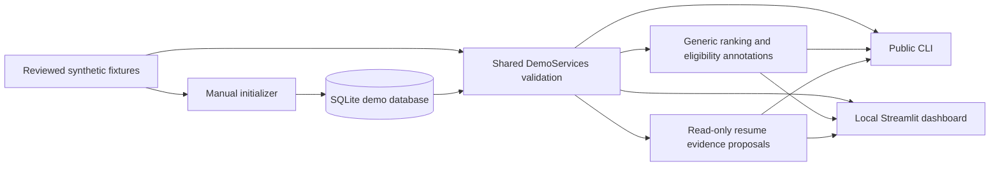

# Internship Agent 2027

A local Python demonstration of explainable internship matching, preparation
tracking and evidence-based review of one general resume.

**This is an offline synthetic demo: every candidate, project, job and preparation
record is authored fiction.** It demonstrates the workflow and public backend;
real applicant onboarding is deferred.

## What works today

- Ten fictional jobs in SQLite, with deterministic ranking and traceable evidence.
- Separate eligibility, relevance and preparation state; UNKNOWN needs human review.
- Four preparation records and their history, viewed without changing them.
- Five exact, source-anchored resume proposals with stable IDs and fingerprints.
- A small read-only CLI and a four-page local Streamlit dashboard.
- Explicit initialization with interruption recovery and no-overwrite safeguards.

| Capability | Current status and boundary |
|---|---|
| Storage, deduplication and progress | SQLite backend implemented; initialization is manual |
| Ranking | Configurable evidence-based heuristic; not an admission probability |
| Application tracker | Fictional preparation history; no submission/status-edit control |
| General resume review | Proposals only; no editing, approvals or Resume Apply |
| DOCX extraction | Narrow paragraph/run subset; many ordinary Word structures refused |
| Dashboard | Read-only, `127.0.0.1` only; no public hosting |
| Greenhouse, Lever and Ashby adapters | Backend code and mocked tests; not exposed by this demo; no live verified registries |
| Real applicants/live discovery | Deferred; no private-input fallback or live discovery command |
| Distribution | Source checkout/extracted source archive; standalone wheel lacks demo assets |

## Requirements

The verified target is **Windows 11, AMD64, Python 3.12.10 and Streamlit 1.65.0**.
Use Python 3.12 and PowerShell, with a new `.venv` inside the source root.
Streamlit is pinned because the safety launcher uses version-sensitive APIs.
Do not upgrade it or bypass the launcher with an unrestricted `streamlit run`.

Start with a reviewed source checkout or extracted source archive. Open PowerShell
in the folder containing this README, `pyproject.toml`, `demo/` and `scripts/`.
No public repository URL or release exists yet. Do not copy another project's
venv or database. Run every command below from this **source root**.

[`requirements/windows-py312.lock`](requirements/windows-py312.lock) records
40 tested dependency versions and wheel hashes for Windows/Python 3.12. It is not
a cross-platform lock or security certification. P4A verified local-wheel offline
installation; package-index installation and hosted CI have **not** independently run.

## Install

### 1. Create a fresh environment

If the Windows Python launcher is installed, use these commands. Otherwise replace
`py -3.12` with your Python 3.12 executable. Stop after any failed command.

```powershell
py -3.12 --version
if ($LASTEXITCODE -ne 0) { throw 'Python 3.12 is required.' }
if (Test-Path -LiteralPath .venv) { throw 'Use a fresh source folder or review the existing environment first.' }
py -3.12 -B -m venv .venv
if ($LASTEXITCODE -ne 0) { throw 'Environment creation failed.' }
$env:PYTHONDONTWRITEBYTECODE = '1'
Remove-Item Env:PYTHONPATH -ErrorAction SilentlyContinue
```

Activation is optional: commands use the environment executable directly. The
`py` launcher spelling is a convenience; P4A used an explicit Python 3.12.10
executable. Launcher availability was not verified on every Windows installation.

### 2A. Install offline from reviewed local wheels — verified method

Supply a local directory containing the exact wheels in the lock. Wheels are not
bundled with the source. Without matching local wheels, offline installation is
blocked; keep the hashes/pins and seek authorization before downloading packages.

```powershell
$demoWheels = Read-Host 'Path to your reviewed local wheel directory'
& .\.venv\Scripts\python.exe -B -m pip --isolated --disable-pip-version-check install --no-index --no-cache-dir --only-binary=:all: --require-hashes --find-links $demoWheels -r requirements/windows-py312.lock
if ($LASTEXITCODE -ne 0) { throw 'Offline dependency installation failed.' }
```

### 2B. Install from a package index — documented, not independently verified

Use this **instead of 2A** when internet-based package installation is appropriate
and authorized. It contacts PyPI for dependencies, not ATS services. Exact locked
wheels must be available and hash-matching. No online clean install was executed
in P4A/P4B; index availability of every locked artifact is unverified.

```powershell
& .\.venv\Scripts\python.exe -B -m pip --isolated --disable-pip-version-check install --index-url https://pypi.org/simple --no-cache-dir --only-binary=:all: --require-hashes -r requirements/windows-py312.lock
if ($LASTEXITCODE -ne 0) { throw 'Package-index dependency installation failed.' }
```

### 3. Install and check the public source package

After either dependency method, install from the source root. Dependencies and
the build tool are installed already; this stage needs no package index.
`requirements.txt` contains `-e .`, which uses the current working directory.
There is no `--no-deps` shortcut.

```powershell
& .\.venv\Scripts\python.exe -B -m pip --isolated --disable-pip-version-check install --no-index --no-build-isolation -r requirements.txt
if ($LASTEXITCODE -ne 0) { throw 'Source installation failed.' }
& .\.venv\Scripts\python.exe -B -m pip --isolated --disable-pip-version-check check
if ($LASTEXITCODE -ne 0) { throw 'Dependency check failed.' }
& .\.venv\Scripts\python.exe -B -c "import internship_agent; print(internship_agent.__file__)"
if ($LASTEXITCODE -ne 0) { throw 'Import verification failed.' }
```

The import path should be inside this checkout's `src/internship_agent/`.
Installed console/module commands need no PYTHONPATH. See
[clean-install evidence](docs/CLEAN_INSTALL_VALIDATION.md) for exact tested versions,
procedures and the source-versus-wheel distinction.

## Initialize the demo

```powershell
& .\.venv\Scripts\python.exe -B scripts/create_demo.py
if ($LASTEXITCODE -ne 0) { throw 'Initialization refused or failed; preserve existing output and review the Demo Guide.' }
```

Success creates `data/demo/demo.sqlite3`: 10 jobs, 4 preparation records, schema 6,
integrity `ok` and zero foreign-key violations. SQLite is canonical; CSV exports
are inspection snapshots. Generated data/environments are ignored and excluded
from source archives.

**Existing output is refused.** There is no force/reset option. `--resume` only
recovers a validated, owned partial synthetic run; it does not adopt an arbitrary
or completed database. Preserve unexpected output and follow the
[recovery/disposal guide](docs/DEMO_GUIDE.md).

## Use the CLI

After initialization, run these verified commands. All five are read-only; only
the exact validated demo database is selectable. CLI listings omit notes/receipts.

```powershell
& .\.venv\Scripts\internship-agent.exe --help
& .\.venv\Scripts\internship-agent.exe demo-status --database data/demo/demo.sqlite3
& .\.venv\Scripts\internship-agent.exe demo-jobs --database data/demo/demo.sqlite3
& .\.venv\Scripts\internship-agent.exe demo-applications --database data/demo/demo.sqlite3
& .\.venv\Scripts\internship-agent.exe demo-rank --database data/demo/demo.sqlite3
& .\.venv\Scripts\internship-agent.exe demo-rank --database data/demo/demo.sqlite3 --job demo-002
& .\.venv\Scripts\internship-agent.exe demo-resume-review
```

Replace `internship-agent.exe` with `python.exe -B -m internship_agent` for the
module entry point. `demo-002` scores 72.67/100 with separate UNKNOWN eligibility.
Resume review proposes five exact changes while preserving experimental qualifiers
and the source. Exit codes: 0 success/help, 1 refused input, 2 invalid arguments.
See the [CLI guide](docs/CLI_GUIDE.md).

## Open the dashboard

```powershell
& .\.venv\Scripts\python.exe -B scripts/run_dashboard.py --theme light
```

Keep the foreground terminal open. Navigate to `http://127.0.0.1:8501` in a local
browser; no browser opens automatically. The sidebar has **Overview**, **Demo Jobs**,
**Application Tracker** and **General Resume**. Stop the current server before
using `--theme dark`.

**Stop with Ctrl+C in the launch terminal** and wait for shutdown before restarting.
Closing the browser does not stop Python. The Codex terminal did not forward Ctrl+C
during validation. If your terminal has the same issue, identify the process owning
port 8501 and verify it belongs to this checkout's launcher before terminating only
that process. Never stop unrelated Python sessions or widen binding. The
[dashboard guide](docs/DASHBOARD_DEMO_GUIDE.md) explains guards and shutdown limits.
No background service is installed.

## Run tests and local CI checks

Tests use `unittest`, mocked services, synthetic fixtures and temporary databases;
they do not require a previously generated demo.

```powershell
$env:PYTHONDONTWRITEBYTECODE = '1'
Remove-Item Env:PYTHONPATH -ErrorAction SilentlyContinue
& .\.venv\Scripts\python.exe -B -m unittest discover -s tests -v
if ($LASTEXITCODE -ne 0) { throw 'Tests failed.' }
& .\.venv\Scripts\python.exe -B -m pip --isolated --disable-pip-version-check check
if ($LASTEXITCODE -ne 0) { throw 'Dependency check failed.' }
```

For guarded CI-equivalent verification, use this **instead of repeating the suite**.
It runs all tests, temporary demo/CLI smoke checks, package inspection and native
loopback startup/shutdown through the safety launcher:

```powershell
& .\.venv\Scripts\python.exe -B scripts/verify_public_demo.py
if ($LASTEXITCODE -ne 0) { throw 'Offline public verification failed.' }
```

The [prepared Actions workflow](.github/workflows/offline-tests.yml) targets Windows
and Python 3.12. Future dependency installation may use PyPI; application verification
stays offline apart from local loopback transport. **Hosted CI has not run.** No
passing badge, deployment or artifact upload is configured. See [CI Guide](docs/CI_GUIDE.md).

## Architecture

Python services contain business rules; CLI and Streamlit share a validated,
read-only synthetic input boundary. Database access stays in `database.py`.
Ranking/resume proposals do not submit or persist results.



ATS adapters are outside this demo path. Mocked tests cover parsing, discovery and
storage logic; they do not establish live boards, vacancies, sponsorship or employer ownership.

## Privacy and human control

The demo verifies fixed reviewed input hashes, paths, exact SQLite layout and
payloads. Redirected paths, changed/unrelated databases and unexpected fixtures
are refused. No private document search or fallback exists. Source packaging
uses an explicit allowlist in addition to `.gitignore`.

The safe dashboard launcher binds to loopback, disables telemetry/file polling,
excludes global/user secrets and rejects unexpected external reads, network
operations and persistent writes after initialization. These are scoped safeguards,
not an OS-wide sandbox or security certification.

Execution requires an explicit command; no scheduler or startup integration exists.
Humans review eligibility/evidence, perform every final application submission and
confirm success before an APPLIED state. Future resume changes require fresh
reviewed evidence and separate per-change approval; editing/Apply are unavailable.
Simulation, seen versus held-out evaluations, pending publications and uncertainties
remain explicit.

## Compatibility, troubleshooting and release status

| Item | Evidence |
|---|---|
| Windows/Python 3.12 source and extracted sdist | Complete offline workflow verified in P4A; local P4B checks in CI Guide |
| Wheel-only install | Installation/import/help pass; complete demo unsupported because assets are excluded |
| Package-index install/hosted Actions | Commands prepared; not executed or claimed passed |
| Linux | UNVERIFIED; available Ubuntu lacked ensurepip and cached compiled wheels target Windows |
| macOS/other Python or Streamlit versions | Untested; Windows lock is not a portability guarantee |

- **Missing dependency/wheel:** stop; obtain matching reviewed wheels or authorize
  index installation. Keep hashes and pins intact.
- **Wrong import/environment:** use this source root and its `.venv`; reinstall from
  this folder and verify the import path, without another project's environment.
- **Missing/existing/corrupt database:** initialize only when absent. Preserve
  output and consult the Demo Guide; CLI/dashboard never repair it.
- **Port busy:** verify ownership; use only the safe launcher.
- **Unsupported resume structure:** retain the limitation; do not silently flatten
  or rewrite Word content. The demo uses synthetic TXT.

Development used AI assistance from OpenAI Codex for implementation, tests and
documentation under staged human review. AI assistance does not establish evidence
truth, dependency provenance or license approval; these remain human responsibilities.

## License

The first-party public project is released under the [MIT License](LICENSE), with
the notice `Copyright (c) 2026 Zhenyu Wu`. Third-party dependencies retain their
own licenses. MIT does not grant rights to ATS providers, employer job descriptions,
logos, trademarks or other external content.

No GitHub release exists. The human first-party licensing authority review is
complete to the best of the user's knowledge; it is not an independent ownership
finding or guarantee of AI-output copyrightability. Remaining compliance and
publication approval, broader real-user workflows and safe integration coverage,
unverified platforms and final publication review remain blockers. The
[release manifest](PUBLIC_RELEASE_MANIFEST.md) records inventory, exclusions and
historical results. Public screenshots await separate approval.

## Detailed guides

- [Demo fixtures, initialization and recovery](docs/DEMO_GUIDE.md)
- [Evidence-based ranking](docs/RANKING_GUIDE.md)
- [Resume review and limitations](docs/RESUME_REVIEW_GUIDE.md)
- [CLI commands and refusal rules](docs/CLI_GUIDE.md)
- [Dashboard walkthrough and shutdown](docs/DASHBOARD_DEMO_GUIDE.md)
- [P4A clean install and exact dependencies](docs/CLEAN_INSTALL_VALIDATION.md)
- [CI preparation and screenshot review](docs/CI_GUIDE.md)
